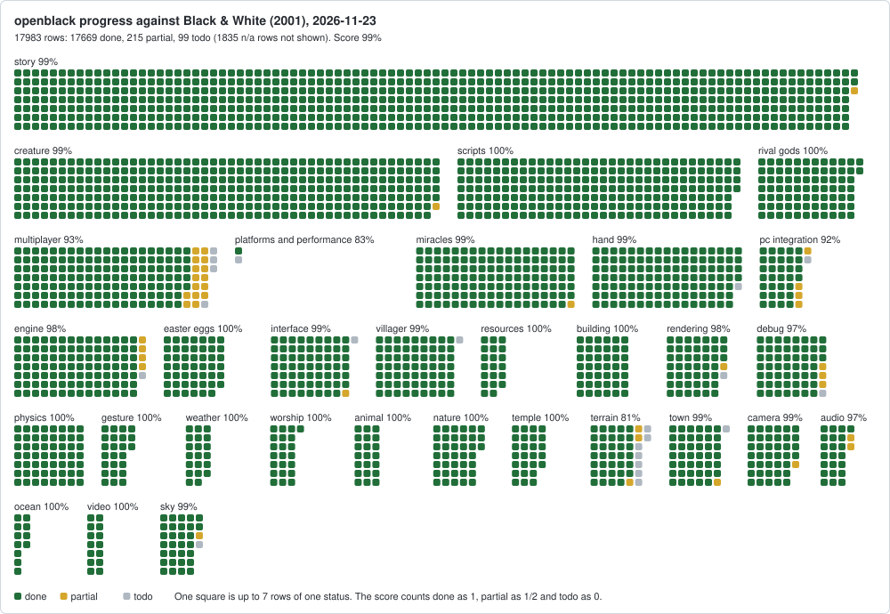

# openblack

## Notice

This is a heavily vibe-coded fork of openblack to gauge what development challenges lie ahead. If you wish to contribute, please help upstream.

---

openblack is an open source reimplementation of [Black & White (2001)](https://en.wikipedia.org/wiki/Black_&_White_(video_game)) written in modern C++20, with [bgfx](https://github.com/bkaradzic/bgfx) for the renderer (Direct3D, Vulkan, Metal, OpenGL and WebGPU) and [EnTT](https://github.com/skypjack/entt) for the game state.

You still need to have the original game assets in order to use this. See further below for an explanation on how to extract them.

---

# Progress

Each square is one or more rows of the progress lists, which break each domain of the game into the behaviours of the original game (snapshot of 2026-11-23); `tools/progress_map.py` draws the map.

# Pre-built Binaries

For the latest build of upstream openblack without having to build it yourself, upstream offers pre-built binaries from its test service. These builds do not have the work of this fork.

[-333333)](https://nightly.link/openblack/openblack/workflows/ci-vcpkg/master/openblack-ubuntu-24.04-master.zip)
[-eeeeee)](https://nightly.link/openblack/openblack/workflows/ci-vcpkg/master/openblack-macos-13-master.zip)
[-0078d4)](https://nightly.link/openblack/openblack/workflows/ci-vcpkg/master/openblack-windows-latest-master.zip)

## Experimental

The following are qualified as exprimental. They have base minimum setup such as compilation and rendering system.
Don't expect to be able to launch without some effort and your own patches.

[-0078d4)](https://nightly.link/openblack/openblack/workflows/ci-cross-compile/master/openblack-x86-windows-master.zip)
[-0078d4)](https://nightly.link/openblack/openblack/workflows/ci-cross-compile/master/openblack-arm64-windows-master.zip) 

[-333333)](https://nightly.link/openblack/openblack/workflows/ci-cross-compile/master/openblack-x86-linux-master.zip)
[-333333)](https://nightly.link/openblack/openblack/workflows/ci-cross-compile/master/openblack-arm64-linux-master.zip)

# Building

Clone the code with its submodules: `git clone --recursive https://github.com/openblack/openblack.git` (use the URL of
this fork to get its code).

If you forgot to add `--recursive`, run `git submodule update --init` in the `openblack/` directory. The only submodule
is [vcpkg](https://github.com/Microsoft/vcpkg), which gets and builds the dependencies.

You need:

* CMake 3.20 or later (the presets file needs it) and Ninja.
* A C++20 compiler: MSVC 2022 on Windows, GCC 13 or Clang on Linux, Apple Clang (Xcode) on macOS.
* Python 3 for the tests that are scripts and for some build steps.
* For the web build only: [Emscripten](https://github.com/emscripten-core/emsdk).

## Presets

The easiest way to start on any platform is to let CMake and vcpkg get all the dependencies. Select a preset in your
IDE, or use the command line:

    cmake --list-presets
    cmake --preset ninja-multi-vcpkg
    cmake --build --preset ninja-multi-vcpkg-debug

The first configure builds all the dependencies with vcpkg, which takes some time. The programs go to `bin/` in the
build folder.

| Preset | What it builds |
|---|---|
| `ninja-multi-vcpkg` | Ninja Multi-Config with vcpkg, for Windows, Linux and macOS. The usual preset for developers. |
| `msvc-17-vcpkg` | A Visual Studio 2022 solution with vcpkg. |
| `xcode-vcpkg` | An Xcode project with vcpkg (macOS). |
| `unix-makefile-vcpkg` | Unix Makefiles with vcpkg. |
| `emscripten-vcpkg` | The web build (WebAssembly), see [Web](#web). |
| `ninja-multi-vcpkg-shipping`, `msvc-17-vcpkg-shipping`, `emscripten-vcpkg-shipping` | The builds that players get: the same as the preset above, but with `OPENBLACK_DEVELOPER_TOOLS` off. The web shipping build also writes its debug information to a separate file. |
| `linux-system-deps` | Linux with the libraries of the system, not vcpkg (for packagers). |
| `android-*-vcpkg`, `ios-*-vcpkg`, `ios-xcode-vcpkg` | Android and iOS. These are experimental. |

Each configure preset has build presets for its configurations, for example `ninja-multi-vcpkg-debug` and
`ninja-multi-vcpkg-release`.

## Programs

| Target | What it is |
|---|---|
| `openblack` | The game. Give it the game folder with `-g` (see [the game data](#extracting-asset-files-from-original-game)). |
| `openblack-server` | The dedicated server of a network game: one land, no window. It builds with the desktop presets (not for Android or the web). |
| `openblack_tests` | The unit tests (GoogleTest). |
| `packtool`, `l3dtool`, `lndtool`, `anmtool`, `glwtool`, `morphtool`, `camtool`, `binktool`, `datatool`, `lhvmtool`, `creaturemindtool` | Tools that read, show and write the file formats of the game. Their readers are in `components/`. |
| `creatureupload` | The desktop tool that uploads a creature. |

Useful switches of the game: `-g <folder>` (the game folder, required), `-b <backend>` (Vulkan, D3D12, D3D11, GL,
Metal or Noop), `-m <mode>` (the window mode), `-n <frames>` (stop after this number of frames). Run
`openblack --help` for the full list.

## Dependencies

vcpkg gets these from `vcpkg.json`. The vcpkg version is the commit of the `vcpkg` submodule.

| Library | What openblack uses it for |
|---|---|
| [bgfx](https://github.com/bkaradzic/bgfx) | The renderer: Direct3D 11 and 12, Vulkan, Metal, OpenGL, and WebGPU in the web build. Its `shaderc` tool compiles the shaders on the host. |
| [EnTT](https://github.com/skypjack/entt) | The entity component system, the service locator and the resource caches. |
| [SDL2](https://www.libsdl.org/) | The window, the input and the platform layer (X11 and Wayland on Linux). |
| [glm](https://github.com/g-truc/glm) | Vector and matrix maths. |
| [spdlog](https://github.com/gabime/spdlog) | Logs. |
| [Dear ImGui](https://github.com/ocornut/imgui) | The debug windows and the editor. |
| [OpenAL Soft](https://github.com/kcat/openal-soft) | Sound output. |
| [dr_libs](https://github.com/mackron/dr_libs) | The decoders of the WAV and MP3 sound files. |
| [stb](https://github.com/nothings/stb) | Image reading and writing. |
| [cxxopts](https://github.com/jarro2783/cxxopts) | The command line switches. |
| [minizip](https://github.com/zlib-ng/minizip-ng) | The compressed files of the game (`.zzz`), through its zlib. |
| [curl](https://curl.se/) | The lobby client and the downloads on the desktop and the server (with OpenSSL and web sockets). The web build uses the fetch of the browser. |
| [sentry-native](https://github.com/getsentry/sentry-native) | The error and crash reports (`OPENBLACK_SENTRY`). Desktop and server only. |
| [GoogleTest](https://github.com/google/googletest) | The unit tests. |

The project also has:

* `vcpkg-overlay-ports/`: changed ports of bgfx (fixes for the Direct3D 12, Vulkan and WebGPU back ends), glm (the
  same order of operations in dot products on all platforms), libunwind (a fixed source archive) and sentry-native.
* `web/ports/` and `web/triplets/`: the ports of SDL2 and OpenAL Soft and the vcpkg triplet of the web build.
* `externals/`: nlohmann JSON and the extra widgets of Dear ImGui.

## CMake options

| Option | Default | What it does |
|---|---|---|
| `OPENBLACK_USE_VCPKG` | on with Visual Studio, else off (the vcpkg presets set it) | Get the dependencies with the vcpkg submodule. |
| `OPENBLACK_DEVELOPER_TOOLS` | on | The debug windows, the editor, the inspector, the test scenarios and the debug keys. The shipping presets set it off. |
| `OPENBLACK_INSPECTOR` | on, but off in Release, Android and web builds | The debug inspector: a local server (`--inspect-port`) that tools use to query and control the game. |
| `OPENBLACK_SENTRY` | on, but off on Android and iOS | Send error and crash reports to Sentry. The game sends them only when the player turns on the option. `OPENBLACK_SENTRY_DSN` gives the DSN; keep it out of the repository. |
| `OPENBLACK_BINK_DECODER` | on | Play the Bink videos of the game. |
| `OPENBLACK_WEB_DEBUG_INFO` | off | Web build: write the debug information to a separate file. |
| `OPENBLACK_SANITIZE` | empty | Build with sanitizers, for example `address,undefined`. |
| `OPENBLACK_WARNINGS_AS_ERRORS` | off | Treat warnings as errors. |
| `OPENBLACK_CLANG_TIDY_CHECKS` | off | Run clang-tidy during the build. |
| `OPENBLACK_TRACE_TIME` | off | Compile time analysis (Clang only). |

## IDEs

### Visual Studio Code
 * Install [Visual Studio Code](https://code.visualstudio.com/Download)
 * Install the [C++ Extension](vscode:extension/ms-vscode.cpptools)
    * The extension might not be required on Linux
    * Install a compiler depending on your platform
        * GNU or Clang compilers on Linux
        * Visual Studio's MSVC on Windows (See Visual Studio)
        * Clang compiler on Mac
 * Install the [CMake Tools Extension](vscode:extension/ms-vscode.cmake-tools)
     * Install [CMake version 3.20+](https://cmake.org/download/)
 * You can simply [open the `openblack` folder directly in Visual Studio Code and select a preset](https://devblogs.microsoft.com/cppblog/cmake-presets-integration-in-visual-studio-and-visual-studio-code/).

### Visual Studio 2022
* Install [Visual Studio](https://visualstudio.microsoft.com/downloads/)
    * Select an appropriate MSVC C++ Component for your version
    * Select an appropriate Windows SDK Component for your version
    * Select the C++ CMake tools for Windows Component
* You can simply [open the `openblack` folder directly in Visual Studio and select a preset](https://devblogs.microsoft.com/cppblog/cmake-presets-integration-in-visual-studio-and-visual-studio-code/).

### Clion
* Install [Clion](https://www.jetbrains.com/clion/download/)
* You can simply [open the `openblack` folder directly in CLion and select a preset](https://www.jetbrains.com/help/clion/cmake-presets.html).

### XCode
* Install [XCode](https://apps.apple.com/ca/app/xcode)
* Install the homebrew dependencies using [homebrew](https://brew.sh/):  `brew install cmake ninja pkg-config`
* Run `sudo xcode-select --reset` after installing cmake
* You need to configure using the cmake preset `xcode-vcpkg` using cmake in either the GUI or using the command line argument `--preset xcode-vcpkg`

### Command Line
* Your usual build tool-chain.
    * Ubuntu / Debian: `# apt install build-essential cmake ninja-build`
    * Arch Linux / Manjaro: `# pacman -S base-devel cmake ninja`
* You can generate the cmake build preset using `cmake --preset` and you can list the presets using `cmake --list-presets`

## Web

The web build runs the game in a browser. The game draws with WebGPU, or with WebGL 2 when the browser has no WebGPU.
The game runs on a worker thread and uses JSPI (JavaScript Promise Integration) to wait for the browser. Thus it needs
a browser with JSPI. For Safari, use version 27 or later. There is no build without JSPI.

* Get [emsdk](https://github.com/emscripten-core/emsdk), then run `emsdk install latest` and `emsdk activate latest`.
* Set the `EMSDK` environment variable to the emsdk folder.
* Configure and build the `emscripten-vcpkg` preset (or `emscripten-vcpkg-shipping` for players).
* The page is in `web/page`. The player gives the game folder from the disk on the page; the build has no game data.
* The game threads need the COOP and COEP headers. To test on your computer, serve the output folder with
  `python web/scripts/serve.py <folder> <port>`, which sends them.

## Game server

`openblack-server` is the dedicated server of a network game. It is part of the desktop presets. To build only the
server on Linux for a host, use the shipping preset:

    cmake --preset ninja-multi-vcpkg-shipping
    cmake --build --preset ninja-multi-vcpkg-shipping-release --target openblack-server

The server also needs the game data (`-g`). Run `openblack-server --help` for its switches, for example `--lan` for a
game on the local network.

## Android

The Android build is experimental.

* Install [Android Studio](https://developer.android.com/studio)
* Install a recent SDK and an NDK of at least 23
* Open openblack from the `android` directory
* Set the SDK and NDK in the project settings
* Do gradle configure which will run cmake configuration and compile the vcpkg dependencies
* Build the project for either a virtual device or a connected device
* Currently requires user to upload game assets to `/data/local/tmp/bw` and `chmod -R a+wrx /data/local/tmp/bw` with adb

## Tests

The build makes the tests when CMake finds GoogleTest (vcpkg gives it) and the build is not a cross compile. Run them
with CTest:

    ctest --preset ninja-multi-vcpkg-debug
    ctest --test-dir <build folder> -C Debug -R creature

`-R` runs only the tests whose names match. Some tests are Python scripts; CTest runs them when CMake finds Python 3.
The tests do not need the game data. A small number of tests use the game data when the environment variable
`OPENBLACK_GAME_PATH` gives the game folder, and skip without it.

### Sanitizer job (AddressSanitizer and UBSan)

Test code can read freed memory and still pass on some test orders. To find this, build the tests with sanitizers in a
separate Debug build folder (Clang or GCC; MSVC supports only `address`):

    cmake -G Ninja -S . -B build-asan -DCMAKE_BUILD_TYPE=Debug -DOPENBLACK_SANITIZE=address,undefined <your usual options>
    cmake --build build-asan --target openblack_tests
    cd build-asan/test && ../bin/openblack_tests && ../bin/openblack_tests --gtest_shuffle --gtest_random_seed=1

Run the program plain and shuffled. Any report from a sanitizer is a bug to fix. The option is off by default and does not
change the normal builds.

## Configuration for using System Dependencies (Recommended for packagers)

If you don't want to use vcpkg; CMake will use system libraries, or manually specified package directories.

CMake will find the required libraries as long as they provide a [proper config file](https://cmake.org/cmake/help/latest/guide/using-dependencies/index.html#libraries-providing-config-file-packages).

### Arch Linux

Install [openblack-git](https://aur.archlinux.org/packages/openblack-git/) from the AUR which builds and installs directly for all Arch Linux derived distros such as Manjaro. This will require pacman to install all required dependencies.

The preset to use is `"linux-system-deps"   - Linux (System Deps)`

## Contributing
Contributions are always welcome, whether it's modifying source code to add new
features or bug fixes, documenting new file formats or simply editing some
grammar.

You can also join the [Discord for development discussion](https://discord.gg/5QTexBU)
if you are unsure of anything.

### Git hooks and clang-format 17
All C++ code must match clang-format **17** (the file `.clang-format`). Other versions of clang-format format some
lines differently, so use version 17.

The repository has two hooks. `sh tools/githooks/install.sh` installs both:

* `pre-commit` checks the staged lines of C++ files in `src`, `apps`, `components` and `test`. It does not check lines
  that you did not change. If a line does not match, the commit stops and the hook prints the command that fixes it.
* `pre-merge-commit` checks every C++ file that a merge changes, as whole files.

On Windows PowerShell, run the script with Git Bash:
`& "C:\Program Files\Git\bin\sh.exe" tools/githooks/install.sh`. The script puts the hooks in the common git
folder, so they apply to all worktrees of the repository. If a different hook is already there, the script saves it
as `<name>.bak`.

The hooks look for clang-format 17 in this order:

1. The environment variable `OB_CLANG_FORMAT_DIR`. It names the folder that holds `clang-format` and `git-clang-format`.
2. The git setting `openblack.clangFormatDir` (`git config --global openblack.clangFormatDir <folder>`).
3. The value `tools.clangFormat17Dir` in `.claude/openblack.local.json`.
4. `clang-format-17` or `clang-format` on `PATH`.

To get clang-format 17, run `python -m pip install --target <folder> clang-format==17.0.6`.

# Extracting asset files from original game

As mentioned before, the original game assets are required in order to run
openblack. Since these data are copyrighted, **we won't provide them**, so please
don't ask. Here is a guide for extracting them from the original game.

## Prerequisites

You will need the following:

- The original installer (usually on a CD)
- [Official patch 1.10](https://www.bwgame.net/downloads/v1-1-patch.129/)
- [Official patch 1.2](https://www.bwgame.net/downloads/v1-2-patch.130/)
- Not needed (but will not compromise the extraction): [Unofficial patch 1.42](https://www.bwgame.net/downloads/black-white-unofficial-patch-v1-42.1418/)

**Do not install 1.3, it is a patch to add P5 Power Glove support and is generally unstable**

## Installation

### On Windows

1. Install the game from the installer, remember the installation directory
(`C:\\Program Files (x86)\\Lionhead Studios\\Black & White\\` is the default)
2. Install the official patch 1.10 (in the same directory)
3. Install the official patch 1.2 (in the same directory)

### On Linux and macOS

If you run on Linux or macOS, you can install the game with Wine
([App Page on WineHQ](https://appdb.winehq.org/objectManager.php?sClass=application&iId=156)).

1. Install `wine`
2. Run `wine Setup.exe` from the directory containing the installer, don't
   change the install path
3. Run `wine Black_White_Patch_v1.100.exe` from the directory containing the
   first patch (adapt the command in case the filename isn't exactly that)
4. Run `wine black_white_patch_v1_20.exe` from the directory containing the
   second patch (adapt too)
5. In case you would like to install the unofficial patch, it requires .NET 2.0,
   that can be installed with `winetricks dotnet20sp2` (you should install
   `winetricks first`)

All the files should be installed in the following directory:
`~/.wine/drive_c/Program Files (x86)/Lionhead Studios Ltd/Black & White`

## Getting the assets

The folders you're interested in are the `Audio`, `Data` and `Scripts` folders in the
installation directory. You can use them from there or make a copy to the
location of your choice.

### Using them in place

If you want to use them from there, remember the installation directory chosen
in the installation step, unless you changed it, it should be either:

- either`C:\\Program Files (x86)\\Lionhead Studios\\Black & White\\`
- or `~/.wine/drive_c/Program Files (x86)/Lionhead Studios Ltd/Black & White`

This is the path you will give to openblack (using the `-g` or `--game-path` switch). The web build asks for this folder on its page.

If you prefer to copy the data (e.g. if you want to uninstall the original
game), just copy the `Audio`, `Data` and `Scripts` folders to the desired new location,
and give the path to this location to openblack (using the `-g` flag).

# License

openblack is released as open source software under the [GPL v3](https://opensource.org/licenses/gpl-3.0.html)
license, see the [license](./license) file in the project root for the full license text.
